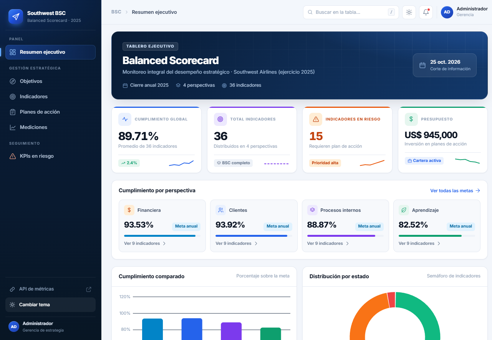
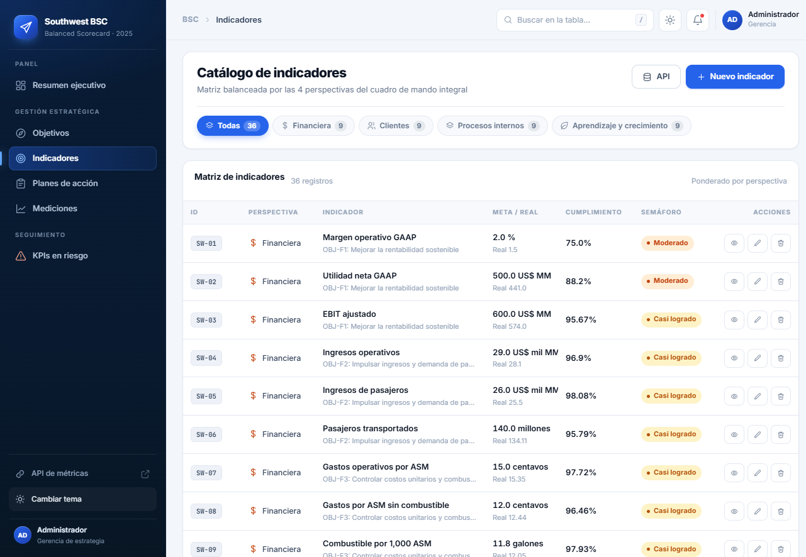
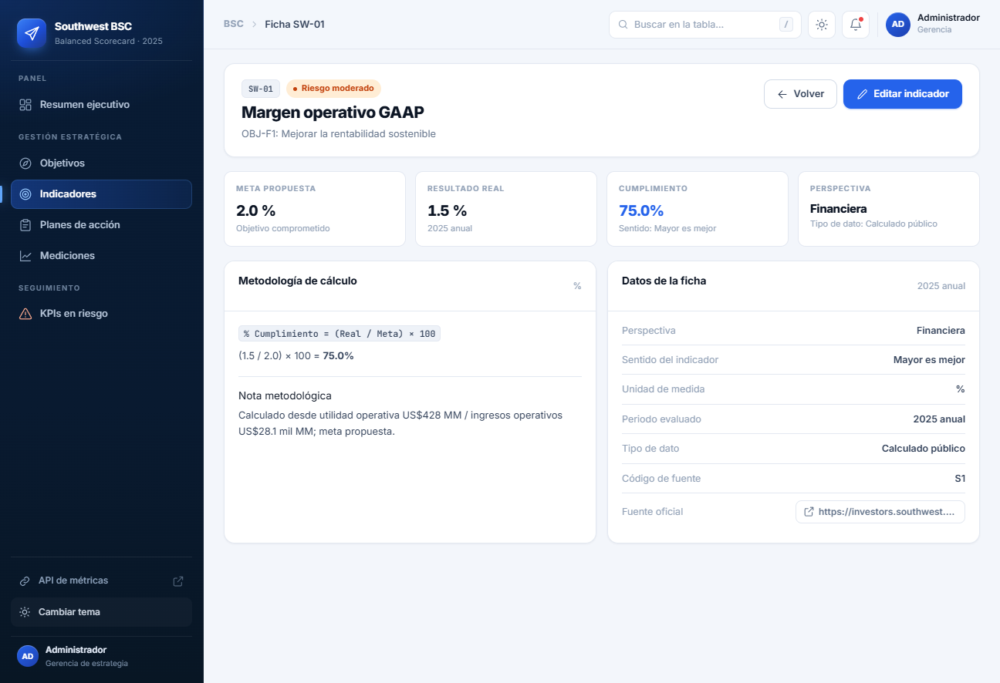

# Balanced Scorecard · Southwest Airlines 2025

Aplicación web para gestionar un **Cuadro de Mando Integral (BSC)** completo: objetivos estratégicos, indicadores (KPIs), planes de acción correctiva y registro de mediciones, con tablero ejecutivo, semáforos de cumplimiento y API REST de consulta.



## Funcionalidades

- **Tablero ejecutivo** con cumplimiento global, distribución por perspectiva, indicadores en riesgo, presupuesto comprometido y gráficos (Chart.js).
- **CRUD completo** de objetivos, indicadores, planes de acción y mediciones.
- **Cálculo automático** del porcentaje de cumplimiento y del semáforo (supera meta, logrado, casi logrado, riesgo moderado, riesgo alto, crítico).
- **Filtros por perspectiva** y vista específica de indicadores en riesgo.
- **Ficha técnica del KPI** con fórmula, nota metodológica, fuente oficial y datos de la ficha.
- **Búsqueda global** en la tabla activa (atajo `/`).
- **Tema claro/oscuro** persistente y diseño responsive (sidebar colapsable, rail lateral en pantallas grandes).
- **API REST** de solo lectura para integraciones.

| Catálogo de indicadores | Ficha del indicador |
| --- | --- |
|  |  |

## Stack

| Capa | Tecnología |
| --- | --- |
| Lenguaje | Java 21 |
| Framework | Spring Boot 4.0.5 · Spring Framework 7 |
| Vistas | Thymeleaf 3.1 |
| Persistencia | Spring Data JPA · Hibernate 7 · H2 en memoria |
| Build | Gradle 9.4 (wrapper incluido) |
| Frontend | CSS propio + sprite SVG inline · Chart.js (CDN) |

## Cómo ejecutarlo

Requisitos: **JDK 21**. No hace falta instalar Gradle ni una base de datos.

```bash
# Windows
gradlew.bat bootRun

# Linux / macOS
./gradlew bootRun
```

Luego abre <http://localhost:8080>.

La base H2 se crea en memoria al arrancar y se destruye al detener la aplicación (`ddl-auto=create-drop`). En cada inicio se cargan datos de ejemplo: **36 KPIs, 12 objetivos estratégicos y 5 planes de acción** del caso Southwest Airlines 2025.

## Rutas principales

| Ruta | Descripción |
| --- | --- |
| `/dashboard` | Tablero ejecutivo |
| `/kpis` | Catálogo de indicadores (filtro `?perspectiva=...`) |
| `/kpis?soloRiesgo=true` | Indicadores con semáforo en riesgo |
| `/kpis/detalle/{id}` | Ficha técnica del indicador |
| `/objetivos` | Objetivos estratégicos |
| `/planes` | Planes de acción correctiva |
| `/mediciones` | Registro de mediciones |
| `/api/bsc/kpis` | API REST de indicadores |
| `/api/bsc/planes` | API REST de planes |
| `/api/bsc/metricas` | Métricas agregadas para el tablero |

## Estructura del proyecto

```
src/main/java/pe/edu/upeu/crudproductosh/
├── controller/     controladores web y API REST
├── service/        lógica de negocio y cálculo de semáforos
├── repository/     repositorios Spring Data
├── model/          entidades y enums del BSC
├── config/         carga de datos de ejemplo
└── dto/            objetos de transferencia

src/main/resources/
├── templates/      vistas Thymeleaf (dashboard, listas, formularios, ficha)
│   └── fragments/  layout, topbar, sidebar, sprite de iconos
└── static/css/     sistema de diseño (bsc.css)

docs/capturas/      capturas usadas en este README
BSC_Prototipo/      prototipo estático previo al desarrollo con Spring
```

## Pruebas

```bash
gradlew.bat test
```

Incluye un *smoke test* que renderiza las 19 vistas principales y falla si algún fragmento o expresión Thymeleaf se rompe.

## Alcance y limitaciones

Proyecto académico (UPEU). Pensado como demostración funcional, por lo que:

- No incluye autenticación ni autorización.
- Los borrados se hacen por `GET` y no hay protección CSRF.
- La API REST es de solo lectura y está abierta (`@CrossOrigin("*")`).
- Los datos son de ejemplo y no persisten entre reinicios.

> Los valores del caso (Southwest Airlines 2025) son demostrativos y no constituyen información financiera oficial.
